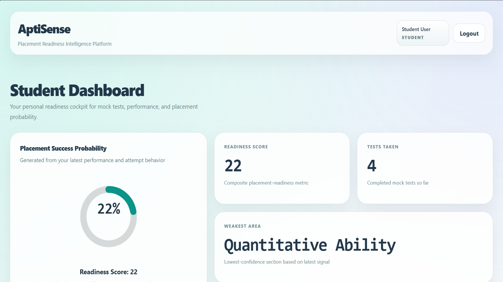
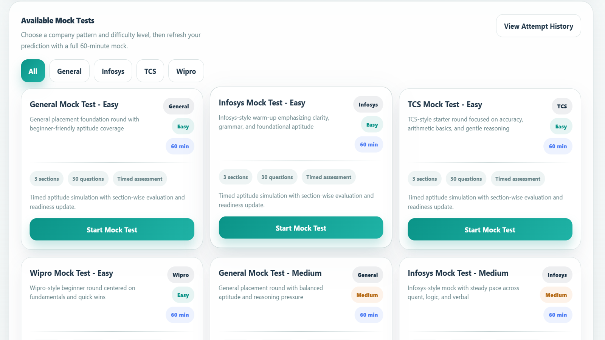
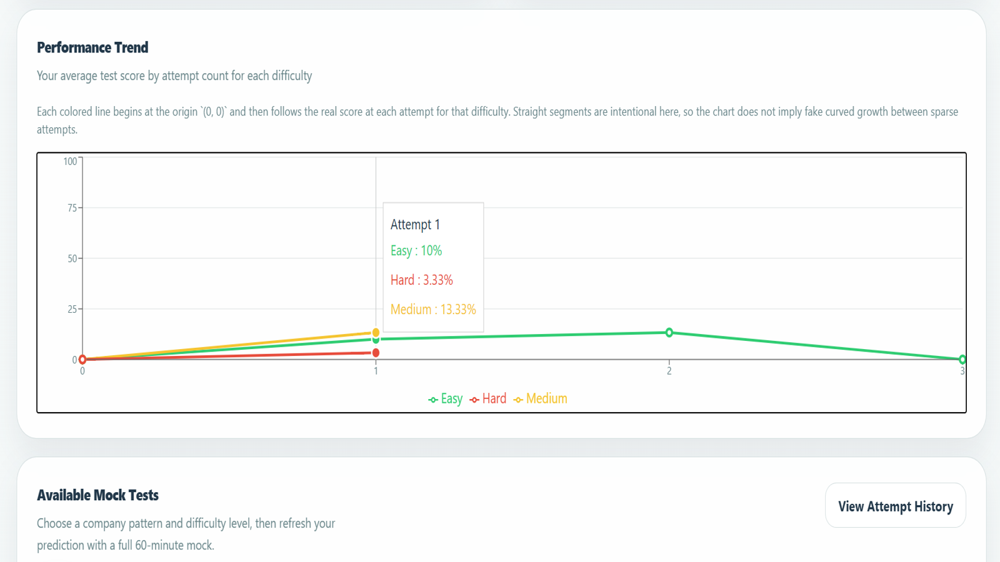
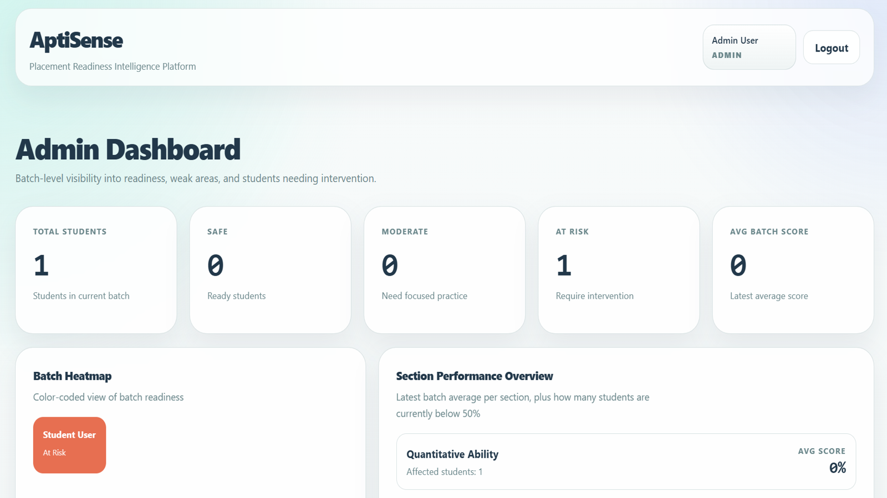

# AptiSense

Aptitude assessment and placement-readiness platform for college students. Students take company-style mock tests (Quant, Logical, Verbal), track their performance over time, and get a readiness score with weak-topic feedback. Admins (placement coordinators) manage tests, upload study notes, and see batch-wide analytics.



## Features

**Students**
- Mock tests modelled on General, Infosys, TCS and Wipro patterns, at Easy / Medium / Hard difficulty (360-question bank)
- Instant scoring with section-wise breakdown (Quant / Logical / Verbal)
- Performance history and trend charts
- Placement-readiness score, success probability and weak-topic detection

**Admins**
- Create, edit and delete tests
- Upload and manage study notes (PDF)
- Batch analytics, topic heatmap and weak-topic reports, split by difficulty
- Drill-down view for any individual student

**Platform**
- JWT authentication with role-based access (student / admin)
- Registration restricted to institute email addresses (`@apsit.edu.in`)
- Backend test suite using Node's built-in test runner

## Tech Stack

| Layer | Tech |
|---|---|
| Frontend | React 19, TypeScript, Vite, Tailwind CSS 4, React Router, Recharts |
| Backend | Node.js, Express, MongoDB (Mongoose), JWT, bcrypt |
| Scoring service | Python, FastAPI |

## Architecture

```text
React frontend (5173)  ──►  Express API (5000)  ──►  MongoDB
                                   │
                                   └──►  FastAPI scoring service (8000)
```

The scoring service computes the readiness score from a student's section scores, average score, number of tests taken and attempt rate using a weighted formula, and returns each factor's relative contribution so the UI can explain the result.

## Running Locally

Prerequisites: Node.js 20+, Python 3.10+, and a MongoDB instance (local or Atlas).

**1. Backend**

```bash
cd backend
cp .env.example .env   # then fill in MONGO_URI and JWT_SECRET
npm install
npm run seed           # creates demo admin and student accounts
npm run dev
```

**2. Scoring service**

```bash
cd ml-service
python -m venv .venv
source .venv/bin/activate   # Windows: .venv\Scripts\activate
pip install -r requirements.txt
uvicorn main:app --port 8000
```

**3. Frontend**

```bash
cd frontend
cp .env.example .env
npm install
npm run dev
```

Open http://localhost:5173.

The seed script creates two local demo accounts: `admin@apsit.edu.in` / `admin1234` and `student@apsit.edu.in` / `student1234`. Change these before deploying anywhere public.

## Tests

```bash
cd backend
npm test
```

## Screenshots

| Mock tests | Performance trend | Admin dashboard |
|---|---|---|
|  |  |  |

## Project Structure

```text
backend/      Express API: routes, Mongoose models, auth middleware, seed data, tests
frontend/     React + TypeScript single-page app
ml-service/   FastAPI readiness-scoring service
docs/         Screenshots and project presentation guide
```
